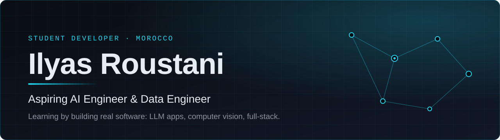

  

 

## About

I'm a high school student from Morocco working toward a career in **AI engineering and data engineering**. I learn by building: so far that means LLM-powered apps, a client-side computer vision tool, and full-stack web and Android projects, all in TypeScript.

My current focus is **Python**, which I'm still at a beginner level in, along with the fundamentals behind **data engineering**, **LLMs** and **AI agents**.

## Featured projects

### EduIA

**Multilingual educational AI assistant** for students, from primary school to the final year of high school.

A chat assistant that adapts its vocabulary and explanations to the student's level and answers in French, English or Arabic.

- Adaptive system prompt per school level and answer style (short, step by step, with examples, and more)
- Voice mode using the browser's speech APIs
- Math rendering with KaTeX and a math input toolbar
- Revision panel, conversation history and local persistence in the browser
- Android build through Capacitor

**Stack:** Next.js, React, TypeScript, Tailwind CSS, Radix UI, Zustand, IndexedDB, KaTeX, Groq API (OpenAI-compatible SDK), Capacitor

[View repository](https://github.com/roustanininja-cell/eduia)

### AURA LABS

**Client-side computer vision application** for facial landmark and proportion analysis, built privacy-first.

Face geometry is computed in the browser with MediaPipe, so photos are not uploaded to a server. The app states clearly what its measurements can and cannot say.

- Face landmark overlay and proportion metrics, with a geometric fallback detector
- Progress tracking with before and after comparison
- Local storage with JSON export and import
- No accounts, no analytics, no paid API

**Stack:** Next.js, React, TypeScript, Tailwind CSS, MediaPipe Tasks Vision

[View repository](https://github.com/roustanininja-cell/mog-academy-free)

### ICONU Drougri

**Personal full-stack equipment management project.** A web app for tracking company equipment, loans and maintenance.

- Dashboard with charts, inventory, categories, employees, loans, maintenance and history
- Authentication with user roles (administrator, manager, employee)
- Validated forms, sortable tables, and PDF, Excel and CSV exports
- Android wrapper through Capacitor

**Stack:** Next.js, React, TypeScript, Tailwind CSS, Prisma, PostgreSQL, NextAuth, Zod, Recharts, Capacitor

[View repository](https://github.com/roustanininja-cell/iconu-drougri)

### SensForge

**Mouse sensitivity converter and aim calibration tool** for PC games.

Converts sensitivity between 25 games while keeping the same physical mouse distance per 360 degree turn, and lets players calibrate their own aim.

- Conversion engine based on per-game yaw values, with a unit test suite
- Sensitivity recommender and a guided calibration method
- In-browser reaction and flick trainer
- Presets stored locally, with JSON import and export

**Stack:** React, TypeScript, Vite, Vitest, oxlint

[View repository](https://github.com/roustanininja-cell/aim-convertor)

## Technical stack

Only technologies I have used in the projects above.

| Area | Technologies |
| :-- | :-- |
| **Languages** | TypeScript |
| **Frontend** | React, Next.js, Vite, Tailwind CSS, Radix UI, Recharts, KaTeX |
| **Backend & Database** | Next.js API routes, Prisma, PostgreSQL, NextAuth, Zod, IndexedDB |
| **AI & Computer Vision** | LLM chat through the Groq API (OpenAI-compatible SDK), MediaPipe Face Landmarker, Web Speech API |
| **Mobile** | Capacitor (Android) |
| **Developer Tools** | Git, GitHub, Vitest, ESLint, oxlint, npm |
| **Learning focus** | Python |

## Learning roadmap

What I'm working on next, in the order I plan to approach it.

1. **Python fundamentals:** syntax, data structures, writing small scripts and tests
2. **Data engineering basics:** SQL and PostgreSQL in depth, moving and cleaning data
3. **LLM applications:** prompts, API integration and evaluation, building on what I did in EduIA
4. **AI agents:** tool use and multi-step workflows
5. **Engineering quality:** more tests, CI, and clearer documentation across my repositories

  Student developer from Morocco, learning in public.

<!--
Contact section intentionally left out until verified links are added.
When ready, add a "Contact" section above the footer with the links you want public
(email, LinkedIn, portfolio).
-->
